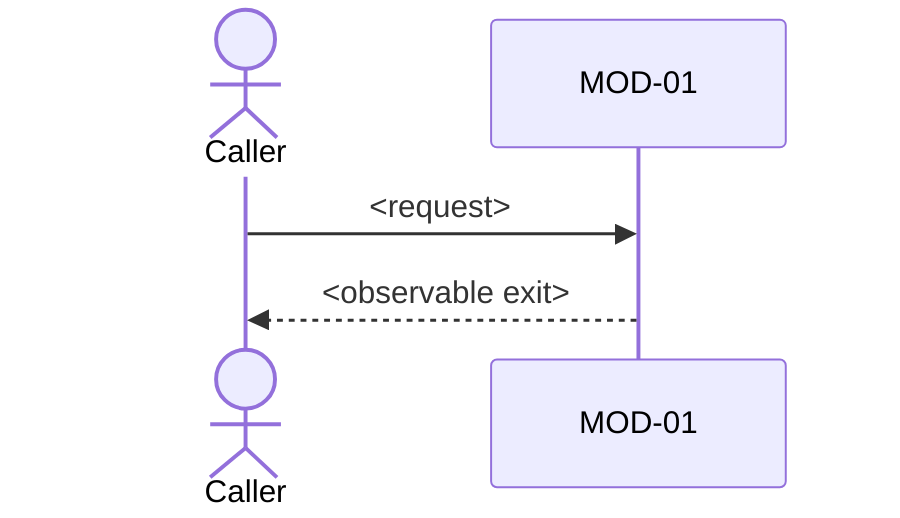

# FLOW-01 — <name>

trigger: <request / cron fire / operator command / event>
exit: <what the caller observes when it is done — response shape, side effect,
state change. Not "success".>

**Actors:** <...>
**Preconditions:** <...>
**Contracts touched:** CT-01, CT-02

## Steps

Each step names the module that executes it. Each step carries its own failure
path and the result the caller sees.

| # | step | module | on failure (caller sees) |
|---|---|---|---|
| 1 | <action> | MOD-01 | <status / retry / no-op> |

## Branches

| branch | condition | outcome |
|---|---|---|
| happy | <...> | <...> |
| duplicate / concurrent | <same request twice, two callers at once> | <...> |
| empty / day one | <nobody has written the state yet> | <...> |
| failure | <...> | <...> |

## State transitions

| entity | from | to | guard |
|---|---|---|---|
| <entity> | <state> | <state> | <condition> |

## Data

- reads: CT-01 (<which fields>)
- writes: CT-02 (<which rows/keys>, writer module)

## Timing

| budget | value | evidence |
|---|---|---|
| timeout | <ms> | FACT-nn |

## Diagram

